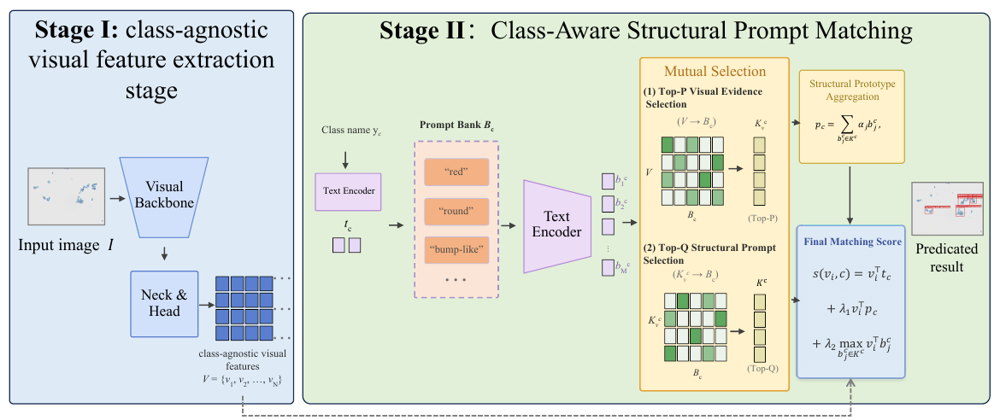
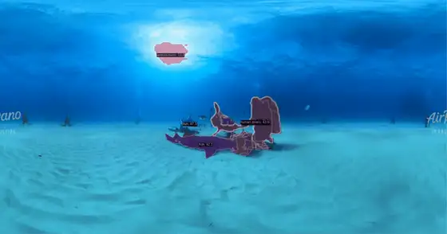
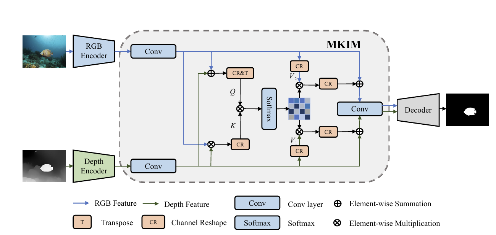

<h2 class="section-title" id="publications">发表论文Publications</h2>

<!--
  新增论文：复制下面一整个 
 … 
，改掉图片、标签、标题、作者、简介和链接即可。
  图片放在 /paperimgs/ 下；没有图片时删掉 <a class="paper__media …"> 那一行。
-->

IEEE BIBM 2026CCF-B第一作者

<h3 class="paper__title"><a href="https://arxiv.org/abs/2609.31314">CytoSPM: Open-Vocabulary Cytopathology Detection with Structured Prompt Bank</a></h3>

<strong>Wenjie Li</strong>#, Zishan Xu#, Jinyang Huang, Zhengxin Nie, Shichao Kan, Yixiong Liang*

构建首个多域开放词汇细胞病理检测基准 PentaCyto（5 个领域、33 类、16.6 万图、94.1 万框）。模型先定位细胞，再将图像特征与各类细胞的名称和形态描述比对，以识别新类别。Novel AP 达 <strong>15.00</strong>（较 YOLO-World-L 高 1.30），推理速度 <strong>25.8 FPS</strong>。

<a href="https://arxiv.org/abs/2609.31314"><i class="fas fa-file-alt" aria-hidden="true"></i>论文</a><a href="https://github.com/CVIU-CSU/CytoSPM"><i class="fab fa-github" aria-hidden="true"></i>代码</a><a href="https://huggingface.co/Doilion111/CytoSPM"><i class="fas fa-cube" aria-hidden="true"></i>模型</a>

ICML 2024CCF-A第四作者

<h3 class="paper__title"><a href="https://arxiv.org/pdf/2406.06039">Diving into Underwater: Segment Anything Model Guided Underwater Salient Instance Segmentation and A Large-scale Dataset</a></h3>

Shijie Lian, Ziyi Zhang, Hua Li*, <strong>Wenjie Li</strong>, Laurence Tianruo Yang, Sam Kwong, Runmin Cong

提出首个大规模水下显著性实例分割数据集 USIS10K 与基于 SAM 的 USIS-SAM，可自动生成水下显著性提示。本人参与构建 USIS10K，负责数据采集、去重、标注、格式转换与实验验证。Google Scholar 被引 <strong>100+</strong>，GitHub <strong>100+</strong> Stars。

<a href="https://arxiv.org/pdf/2406.06039"><i class="fas fa-file-alt" aria-hidden="true"></i>论文</a><a href="https://github.com/LiamLian0727/USIS10K"><i class="fab fa-github" aria-hidden="true"></i>代码</a>

ACM MM 2023CCF-A第三作者（学生二作）

<h3 class="paper__title"><a href="https://dl.acm.org/doi/10.1145/3581783.3613826">FSNet: Frequency Domain Guided Superpixel Segmentation Network for Complex Scenes</a></h3>

Hua Li, Junyan Liang, <strong>Wenjie Li</strong>, Wenhui Wu*

提出频域引导的端到端超像素分割网络 FSNet，融合空间域与频域的深层特征，在复杂场景下生成边界贴合更好的超像素。

<a href="https://dl.acm.org/doi/10.1145/3581783.3613826"><i class="fas fa-file-alt" aria-hidden="true"></i>论文</a>

UIC 2024CCF-C共同一作

<h3 class="paper__title"><a href="https://ieeexplore.ieee.org/stamp/stamp.jsp?tp=&arnumber=10925087">HCMANet: Hierarchical Cross-Modality Attention Network for Underwater Salient Object Detection</a></h3>

Yu Wang#, <strong>Wenjie Li</strong>#, Zhiyang Yu, Yi Xue, Hua Li*

<a href="https://ieeexplore.ieee.org/stamp/stamp.jsp?tp=&arnumber=10925087"><i class="fas fa-file-alt" aria-hidden="true"></i>论文</a>

# 共同一作 · * 通讯作者 · 点击图片可放大

<h3 class="gs-pubs__title">全部论文</h3>

<ol id="gs-pub-list" class="gs-pubs__list"></ol>

列表每天自动从 <a href="{{ site.author.googlescholar }}">Google Scholar</a> 同步

